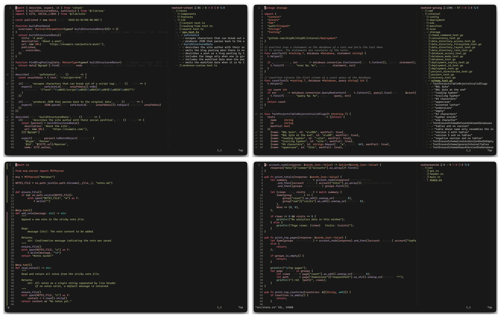
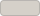

# cutiepro.nvim


A dark pastel colorscheme for Neovim, ported from CutiePro 🩷

Warm pinks, muted olive greens, lilac functions, and soft neutral backgrounds, bringing the CutiePro aesthetic to your Neovim setup.



## Features

- Carefully ported CutiePro color palette
- Treesitter syntax highlighting
- LSP diagnostics and document-reference highlights
- Telescope integration
- nvim-cmp completion highlighting
- Gitsigns support
- nvim-treesitter-context, nvim-dap, neotest, mason, kulala and vim-dadbod-ui highlights
- Indent guides and editor UI highlights
- Lualine theme included
- Matching themes for Terminal.app, Ghostty, Rex, WezTerm and zsh, in [terminal themes](#terminal-themes)
- Optional transparent background
- Safe to reapply when switching colorschemes or reloading configuration

## Requirements

- Neovim 0.10 or newer
- True-color terminal support (`termguicolors`)

## Installation

### vim.pack

Neovim 0.12 ships a built-in plugin manager, `vim.pack`. Add the following to your `init.lua`:

```lua
vim.pack.add({
  { src = "https://github.com/ryanjayleyva/cutiepro.nvim" },
})

require("cutiepro").setup()
vim.cmd.colorscheme("cutiepro")
```

`vim.pack` requires Neovim 0.12 or newer.

### lazy.nvim

Add the following to your plugin specifications:

```lua
{
  "ryanjayleyva/cutiepro.nvim",
  lazy = false,
  priority = 1000,
  config = function()
    require("cutiepro").setup()
    vim.cmd.colorscheme("cutiepro")
  end,
}
```

### Other plugin managers

You can install the repository using your preferred plugin manager. Make sure the repository is on your Neovim runtime path before running:

```lua
vim.cmd.colorscheme("cutiepro")
```

## Configuration

CutiePro works out of the box without calling `setup()`.

```lua
require("cutiepro").setup({
  transparent = false,
})
```

| Option        | Type    | Default | Description                                                                     |
| ------------- | ------- | ------- | ------------------------------------------------------------------------------- |
| `transparent` | boolean | `false` | Clears the backgrounds of the editor, floating windows, and the gutter columns. |

Enable transparency with:

```lua
require("cutiepro").setup({
  transparent = true,
})
```

Then activate the colorscheme:

```lua
vim.cmd.colorscheme("cutiepro")
```

## Lualine

A Lualine theme is included. Set it in your Lualine configuration:

```lua
require("lualine").setup({
  options = {
    theme = "cutiepro",
  },
})
```

## Terminal themes

The files in `extras` are generated from `lua/cutiepro/palette.lua`, so edit the palette and never the generated files. See [Contributing](#contributing).

### macOS Terminal.app

A ready-made profile lives at `extras/terminal/CutiePro.terminal`. Double-click it to import it into Terminal → Settings → Profiles. Regenerate it after palette changes with:

```sh
nvim -l scripts/build-extras.lua
```

Terminal.app only supports 24-bit color on recent macOS releases. On older versions, only the 16 ANSI colors in the profile are exact.

### zsh command-line highlighting

`extras/zsh/cutiepro.zsh` colors the zsh command line with the same palette Neovim uses for shell code. It needs no plugins: paste its contents into `~/.zshrc` (or `source` the file), then run `source ~/.zshrc`.

It also enables macOS `ls` colors (`CLICOLOR`, `LSCOLORS`), which can only use the 16 ANSI colors from the Terminal profile, so import `CutiePro.terminal` too.

If you already use zsh-syntax-highlighting (and p10k/autosuggestions), source `extras/zsh/cutiepro-zsh-syntax-highlighting.zsh` after the plugins instead. It maps the plugin's styles to the same hex colors without it they use ANSI names and won't match Neovim.

Hex colors need a true-color terminal. Otherwise zsh falls back to the nearest 256-color match. The highlighter is a lightweight tokenizer, so heredocs and nested expansions are only partly colored.

### WezTerm

Copy `extras/wezterm/cutiepro.lua` next to your `wezterm.lua` and set `config.colors = require('cutiepro')`.

### Ghostty

Copy `extras/ghostty/cutiepro` to `~/.config/ghostty/themes/cutiepro`, then set `theme = cutiepro` in your Ghostty config.

### Rex

[Rex](https://www.superlogical.com/updates/public-testing-beginning) can import the Ghostty theme. `extras/rex/cutiepro` is a copy of it, so import that file in Rex to use CutiePro.

## Troubleshooting

### Colors look washed out or incorrect

CutiePro sets `termguicolors` automatically when it loads, so the option itself rarely needs attention. Washed-out or incorrect colors usually mean your terminal emulator is not delivering 24-bit color. Check the option first:

```vim
:echo &termguicolors
```

The result should be `1`. If it is `0`, add the following to your Neovim configuration:

```lua
vim.opt.termguicolors = true
```

Your terminal emulator and its active profile must also support 24-bit (true) color. Many emulators disable it in some profiles, or under SSH, even when the emulator advertises support.

### Some plugin elements don't match the theme

Plugin highlight groups can vary between plugin versions and configurations. If you notice missing or incorrect highlights, feel free to open an issue with a screenshot and the relevant plugin details.

## Development

Clone the repository and open Neovim with the included development configuration:

```sh
nvim -u test/minimal_init.lua lua/cutiepro/init.lua
```

After editing the theme files, reapply it inside Neovim:

```vim
:colorscheme cutiepro
```

Run the smoke tests:

```sh
nvim --headless -u test/minimal_init.lua +"luafile test/smoke.lua"
```

The test suite verifies palette values and names, attribute integrity, repeated and transparent application, switching colorschemes, the plugin highlight groups, and the Lualine theme. It runs headless with no plugins installed, so it confirms that the theme defines the right highlight groups rather than exercising each plugin itself.

## Project structure

```
assets/                         # README preview image and palette swatches
colors/cutiepro.lua             # :colorscheme entrypoint
lua/cutiepro/init.lua           # setup and highlight application
lua/cutiepro/palette.lua        # color definitions
lua/cutiepro/highlights.lua     # editor UI, LSP, diagnostics, diff
lua/cutiepro/syntax.lua         # syntax, Treesitter, markup
lua/cutiepro/plugins.lua        # loads the plugin integrations
lua/cutiepro/plugins/           # one module per plugin
lua/lualine/themes/cutiepro.lua # Lualine theme
extras/wezterm/                 # WezTerm color scheme
extras/ghostty/                 # Ghostty theme
extras/rex/                     # Rex theme, a copy of the Ghostty one
extras/terminal/                # macOS Terminal.app profile
extras/zsh/                     # zsh command-line highlighting (standalone and zsh-syntax-highlighting)
scripts/                        # generator for the extras and the palette tables
test/                           # development configuration and tests
```

## Palette

The editor colors reuse the terminal colors where they can. The syntax colors
are the ones the terminal does not need.

### Base colors (ANSI 0-15)

These also set the `:terminal` colors inside Neovim. The tables below are
generated from `lua/cutiepro/palette.lua` by `scripts/build-extras.lua`.

<!-- palette:start -->

| Index | Name              | Color                                            | Hex       |
| ----- | ----------------- | ------------------------------------------------ | --------- |
| 0     | black             |              | `#000000` |
| 1     | red               |                | `#f56e7f` |
| 2     | green             |              | `#bec975` |
| 3     | yellow            |             | `#f58669` |
| 4     | teal              |               | `#42d9c5` |
| 5     | magenta           |            | `#d286b7` |
| 6     | cyan              |               | `#37cb8a` |
| 7     | foreground_muted  |   | `#88847f` |
| 8     | border            |             | `#2e2a27` |
| 9     | accent            |             | `#e5a1a3` |
| 10    | cream             |              | `#e8d6a7` |
| 11    | bright_yellow     |      | `#f3b061` |
| 12    | bright_blue       |        | `#80c5de` |
| 13    | bright_magenta    |     | `#c3a6cb` |
| 14    | bright_cyan       |        | `#9ed7a8` |
| 15    | foreground_bright |  | `#d7c3ba` |

### Editor colors

| Role                  | Color                                                | Hex       |
| --------------------- | ---------------------------------------------------- | --------- |
| background            |             | `#181716` |
| background_panel      |       | `#181818` |
| background_gutter     |      | `#212121` |
| background_cursorline |  | `#242628` |
| background_selection  |   | `#383838` |
| background_popup      |       | `#1f1e1b` |
| foreground            |             | `#d5d0c9` |
| foreground_bright     |      | `#d7c3ba` |
| foreground_muted      |       | `#88847f` |
| border                |                 | `#2e2a27` |

### Syntax colors

| Name   | Color                                 | Hex       | Used for                                    |
| ------ | ------------------------------------- | --------- | ------------------------------------------- |
| orange |  | `#f4b86a` | Special characters, attributes and warnings |
| lilac  |   | `#caa2ca` | Functions and preprocessor                  |
| sky    |     | `#a5b6ce` | Numbers, characters and escapes             |
| mint   |    | `#5dccc3` | Builtin types                               |
| leaf   |    | `#97ca95` | Labels and macros                           |
| pink   |    | `#ef7dc0` | Links and underlined text                   |
| peach  |   | `#e4b99d` | Markdown quotes                             |
| lemon  |   | `#ffef43` | Matching brackets                           |

<!-- palette:end -->

## Contributing

The extras and the palette tables above are generated from `lua/cutiepro/palette.lua`, so edit the palette and never the generated files. Then run this with Neovim 0.10 or newer:

```sh
nvim -l scripts/build-extras.lua
```

Add `--check` to list any generated file that is out of date without writing.

## Credits

- [CutiePro](https://github.com/cutiepro/cutiepro), the original theme and design.
- [cutiepro-zed](https://codeberg.org/wuemeli/cutiepro-zed) by wuemeli, used as the reference for editor color values.
- [cutiepro/helix](https://github.com/cutiepro/helix), used as the reference for additional UI colors.

## License

See LICENSE for licensing information.

This project is an independent port. Please refer to the upstream projects for their respective licenses and attribution requirements.

### Third-party sources and licenses

- **[CutiePro](https://github.com/cutiepro/cutiepro)**, the original theme and design. It is MIT licensed, copyright (c) 2024 jezzy jumble. The upstream LICENSE is at https://github.com/cutiepro/cutiepro/blob/main/LICENSE.
- **[cutiepro-zed](https://codeberg.org/wuemeli/cutiepro-zed)** by wuemeli, the reference for editor color values. It is MIT licensed, copyright (c) 2026 Wuemeli. See the upstream LICENSE at https://codeberg.org/wuemeli/cutiepro-zed/src/branch/main/LICENSE. The specific JSON file used for verification (`themes/cutiepro.json` at commit 7db4e4ba) matches the colors used in this port.
